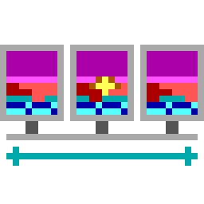
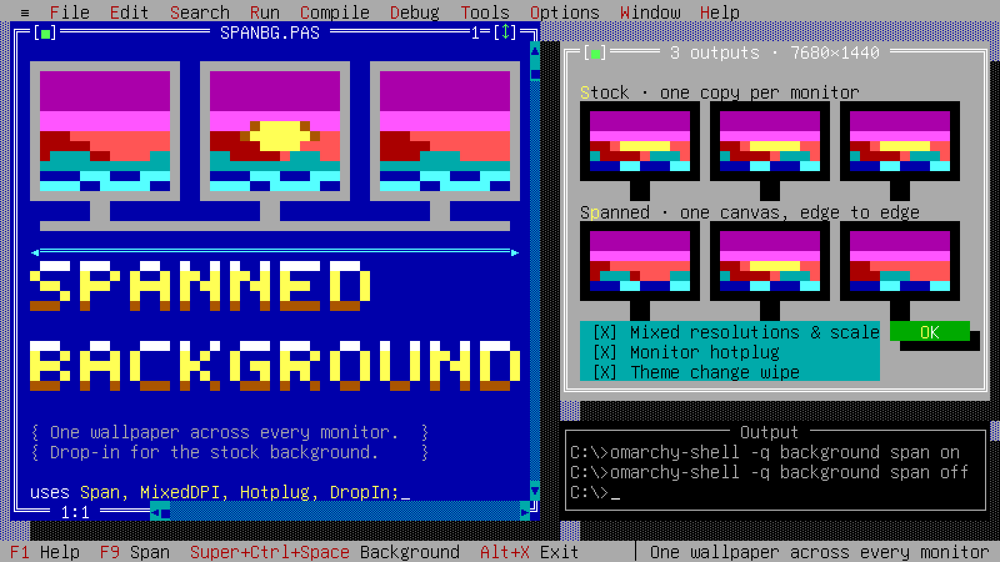

# Spanned-Background - Wallpaper Spanning

One wallpaper across every monitor, in the Omarchy shell. A drop-in
replacement for the stock background service.





The preview is an illustration, not a screenshot: the plugin draws no UI of
its own. What it changes is the wallpaper, which runs as one image across all
of your monitors instead of one copy per monitor.

An [Omarchy](https://omarchy.org) **Quattro** shell plugin that treats all of
your monitors as one continuous canvas and paints a single wallpaper across
them, like the Windows "Span" wallpaper setting.

The image runs edge to edge with no bezel compensation: the last pixel on the
right of one monitor is followed directly by the first pixel on the left of the
next.

It replaces the built-in `omarchy.background` service, and everything else
keeps working as before: `omarchy-theme-bg-set`, the `Super + Ctrl + Space`
background picker, theme switching with its diagonal wipe, and double-clicking
the desktop.

## Requirements

- Omarchy 4.x ("Quattro"). This plugin targets the Quickshell-based
  `omarchy-shell` and does **not** work on Omarchy 3 or earlier.
- Two or more monitors to see any difference. With a single monitor it behaves
  exactly like the stock background service.
- No external packages. It uses only what Omarchy already ships.

## Install

```bash
omarchy plugin disable omarchy.background
omarchy plugin add https://github.com/keasbeexd/omarchy-spanned-background --enable
```

Or manually, from a downloaded copy of this repository:

```bash
mkdir -p ~/.config/omarchy/plugins
cp -r omarchy-spanned-background ~/.config/omarchy/plugins/spanned-background
omarchy plugin validate ~/.config/omarchy/plugins/spanned-background
omarchy plugin disable omarchy.background
omarchy plugin enable keasbeexd.spanned-background
```

> [!IMPORTANT]
> **Disable `omarchy.background` first, in both cases.** Both plugins draw on
> the Wayland background layer and both claim the `background` IPC target, so
> running them together gives you two stacked wallpapers and an IPC conflict.

If the wallpaper does not change straight away, ask the shell to rescan:

```bash
omarchy-shell -q shell rescanPlugins
```

If that does not pick it up, restart the shell or log out and back in.

## Using it

Spanning is on by default. To flip it at runtime:

```bash
omarchy-shell -q background span off      # back to one image per monitor
omarchy-shell -q background span on
omarchy-shell -q background span toggle
```

The choice is saved to `~/.config/omarchy/spanned-background.conf` and read
back when the shell starts. Without that file the plugin uses the
`spanEnabled` default at the top of `SpannedBackground.qml`.

The desktop shortcuts are the same as stock:

| Action | Result |
| --- | --- |
| `Super + Ctrl + Space` | background picker |
| double-click the desktop | background picker |
| right-double-click the desktop | theme switcher |

## Removing

```bash
omarchy plugin disable keasbeexd.spanned-background
omarchy plugin enable omarchy.background
omarchy plugin remove keasbeexd.spanned-background     # if installed via git
```

`omarchy plugin remove` deletes the plugin directory and all bundled scripts.
It does **not** delete:

- `~/.config/omarchy/spanned-background.conf` — the one-line file holding
  `span=on` or `span=off`. Delete it manually if you want no trace.
- In the unlikely case the shell was killed in the middle of saving that file,
  a stray `~/.config/omarchy/.spanned-background.XXXXXXXXXX` temporary (same
  one-line content) can remain next to it. It is safe to delete.

Nothing else is left behind: no daemons, no systemd units, no udev rules, no
`sudoers` entries, no polkit actions, no cache directory, no state directory,
no keyring items, no packages installed, no shared configuration edited.

## How it works

The stock background service creates one background-layer window per screen
and fills each with `PreserveAspectCrop`, which is why every monitor gets its
own full copy of the image.

This plugin keeps one window per screen (that is how Wayland layer shells work)
but changes what each window draws:

1. On startup, and whenever a monitor is added, removed, moved, rotated or
   rescaled, it reads `x`, `y`, `width` and `height` from every `ShellScreen`.
2. It computes the bounding box of the whole virtual desktop.
3. It sizes each window's image to *that* box, shifted by the window's own
   screen origin, and clips it to the screen.

Each output therefore draws only its own slice of one shared image. Every
window asks for the same image at the same size, so Qt's pixmap cache keeps a
single decode for all of them: the same memory use as the stock plugin.

Hyprland places every output in one logical coordinate space, so this works
for mixed resolutions, mixed (including fractional) scale factors, portrait
monitors and stacked arrangements without anything hardcoded for a particular
setup.

The theme-change wipe is computed in that same virtual space and then shifted
into each output's local coordinates, so one diagonal sweeps continuously across
the whole desktop instead of each screen wiping independently.

If the compositor ever returns geometry that does not make sense, the plugin
falls back to stock per-monitor rendering rather than drawing something wrong.

## Notes and caveats

- **Aspect ratio.** The image is scaled to cover the whole virtual desktop and
  whatever overflows is cropped. Two 16:9 monitors side by side make a 32:9
  canvas, so an ordinary 16:9 wallpaper loses half its height (a quarter off
  the top and a quarter off the bottom); three make 48:9 and it loses two
  thirds. Ultrawide or panoramic wallpapers look much better. Nothing is ever
  stretched: the aspect ratio is always preserved.
- **Non-rectangular layouts.** If your monitors are not aligned (say one sits
  200px lower than the other), the bounding box includes an empty L-shaped
  region. That part of the image is not shown on any screen; the parts you can
  see still line up correctly.
- **Fractional scaling.** Alignment is computed in logical pixels, so on
  fractional scale factors the seam can land on a fractional device pixel. Any
  resulting misalignment is sub-pixel and not visible in practice.
- **Memory.** Spanning adds no decodes: every screen shares one cached decode
  of the image, exactly as the stock plugin does.

## What it does on your system

Omarchy plugins run unsandboxed inside the shell process, so here is the full
list of what this one touches. Apart from the wallpaper image itself (loaded by
Qt, see below), every file read and every command goes through a bundled bash
helper in `bin/`. The QML never builds a shell string, and every helper is
started by absolute path with its arguments as separate argv elements.

- **Reads**, via `bin/resolve-bg`, the symlink Omarchy maintains at
  `~/.local/state/omarchy/current/background`. The helper caps `readlink`
  output at 4096 bytes, refuses anything that is not a regular file owned by
  the current user or by root (stock theme wallpapers live under
  `/usr/share/omarchy/themes/`), and rejects paths with control characters
  before the result reaches the wallpaper renderer.
- **Reads**, via `bin/read-conf`, `~/.config/omarchy/spanned-background.conf`
  using `dd iflag=nofollow,nonblock,count_bytes` at most 129 bytes at a time,
  so a symlink or FIFO planted at that name is refused rather than followed
  or blocked on.
- **Writes**, via `bin/write-conf`, the same file. The helper creates an
  unpredictable temporary with `mktemp` in the destination directory (mode 600
  from creation), writes and fsyncs the payload, `mv -f -T`s it over the
  destination and fsyncs the directory. A symlink planted at the destination
  is therefore *replaced* by `rename(2)` rather than written through. The
  value on argv is checked against the closed set `{on, off}` before the
  helper touches the filesystem.
- **Runs**, only when you double-click the desktop, the same two commands the
  stock plugin runs: `omarchy-theme-bg-switcher` / `omarchy-theme-bg-set` and
  `omarchy-theme-switcher` / `omarchy-theme-set`. Each picker runs under
  `timeout -k 2 60` (each setter under `timeout -k 2 30`) in `bin/pick-bg` /
  `bin/pick-theme`, in its own process group; when the shell stops the
  helper, the helper forwards the signal so the picker and everything it
  started exits too. The picker's output is capped at 4 KiB (measured in
  bytes) and control characters are rejected before it becomes an argv
  element of the setter.
- The three file helpers (`resolve-bg`, `read-conf`, `write-conf`) run with a
  cleared environment holding only `HOME` and `PATH=/usr/bin`.
- **Reads** the wallpaper image itself, through Qt's image loader. Every
  path that reaches `Image.source`, whether it comes from `bin/resolve-bg` or
  arrives over IPC, must be an absolute path or `file://` URL, free of control
  characters and at most 4096 characters long.
- **No network access, no elevated privileges, no external packages**, and
  nothing outside `~/.config/omarchy/spanned-background.conf` is ever written.

The `background` IPC target exposes `refresh`, `set`, `setInstant`,
`transition` and `themeTransition` (the same methods as the stock service, so
Omarchy's own tools keep working), plus `span`. Every path argument goes
through the check above. `span` accepts only
`on|off|toggle|true|false|1|0` or an empty string (toggle) and at most 32
characters. `themeTransition`'s two base64 payloads are each capped at
128 KiB decoded before they reach the theme loader.

## Issues

Bug reports and pull requests are welcome at
<https://github.com/keasbeexd/omarchy-spanned-background/issues>. Please include
your monitor layout (`hyprctl monitors -j`) and your Omarchy version.

## License

MIT — see [LICENSE](LICENSE).
